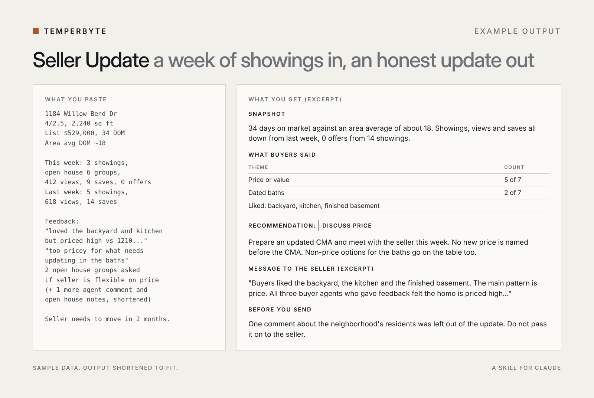
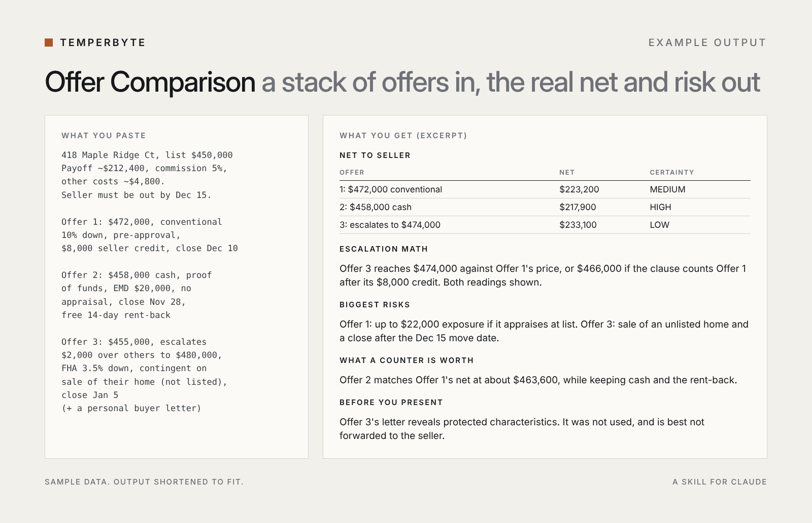
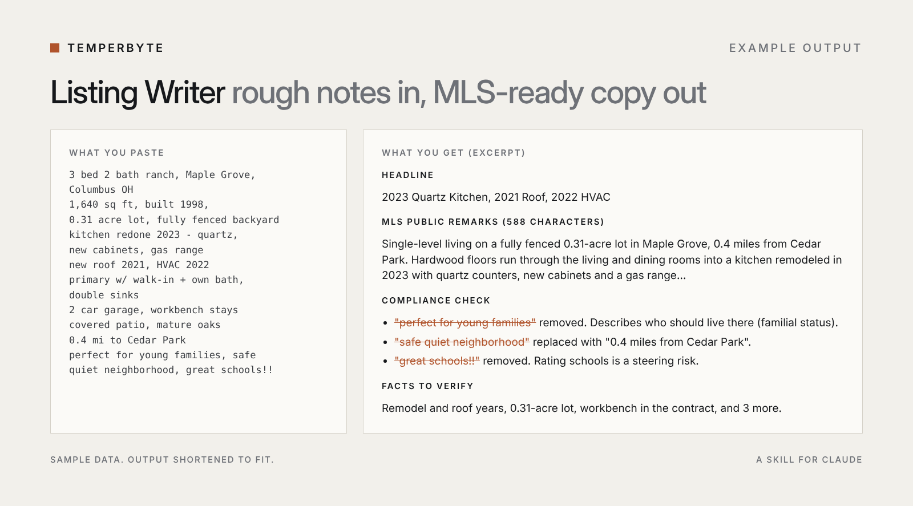
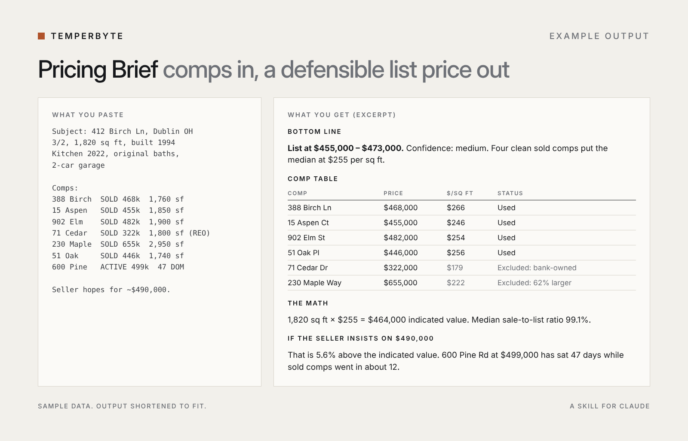
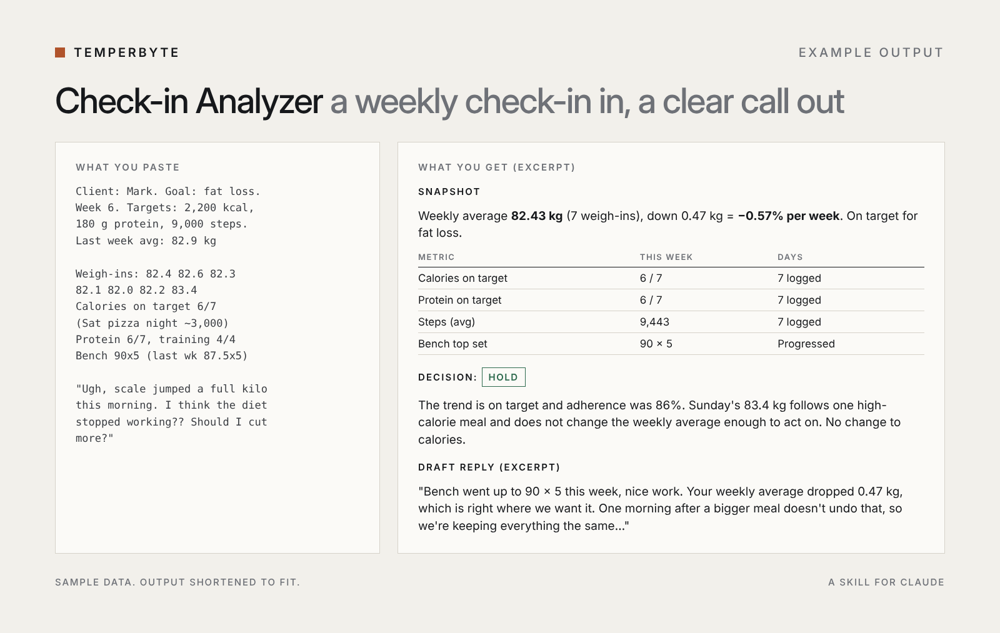
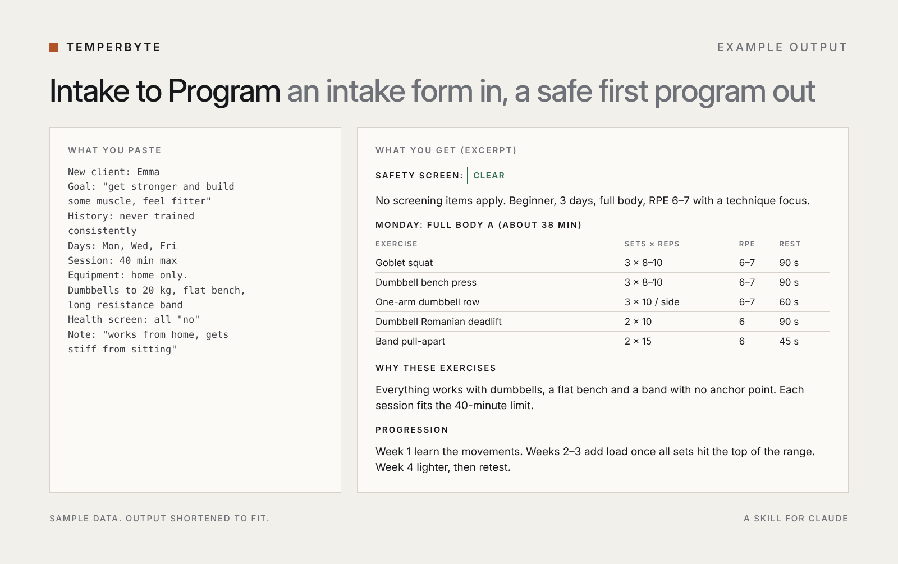

# Temperbyte Skills

Free Claude skills for real estate agents and fitness coaches. Each skill does one job you repeat every week. All skills here are free to download and use.

| Skill | What it does | Download |
|---|---|---|
| `listing-writer` | Turns rough property notes into headlines, MLS public remarks, a website description, feature highlights and a social caption, with a fair housing check and a list of facts to verify | [listing-writer.zip](dist/listing-writer.zip?raw=true) |
| `pricing-brief` | Turns comparable sales into price-per-square-foot math, a suggested list price range with its method shown, a confidence level and seller talking points | [pricing-brief.zip](dist/pricing-brief.zip?raw=true) |
| `checkin-analyzer` | Reviews a coaching client's weekly check-in: trend math, adherence, a hold or adjust decision, red flags and a draft reply | [checkin-analyzer.zip](dist/checkin-analyzer.zip?raw=true) |
| `intake-to-program` | Turns a new client's intake into a pre-exercise safety screen, a client summary and a first 4-week program with progression rules | [intake-to-program.zip](dist/intake-to-program.zip?raw=true) |
| `offer-comparison` | Compares a seller's offers: net to the seller for each, escalation clause math, appraisal and closing risk, what a counter is worth and a seller summary | [offer-comparison.zip](dist/offer-comparison.zip?raw=true) |
| `seller-update` | Turns a week of showings and buyer feedback into activity numbers, feedback themes, one recommendation and a message to the seller | [seller-update.zip](dist/seller-update.zip?raw=true) |
| `program-progression` | Reviews a finished training block lift by lift (estimated 1RM change), flags pain and fatigue, and writes the next 4-week block and a client message | [program-progression.zip](dist/program-progression.zip?raw=true) |
| `coach-content-week` | Turns a coach's notes into a week of video scripts, carousels and captions in their voice, with health claims and client consent checked | [coach-content-week.zip](dist/coach-content-week.zip?raw=true) |
| `listing-writer-lite` | A shorter version: MLS remarks and headlines with a fair housing check | [listing-writer-lite.zip](dist/listing-writer-lite.zip?raw=true) |
| `checkin-analyzer-lite` | A shorter version: weekly trend, a hold or adjust decision, red flags and a short reply | [checkin-analyzer-lite.zip](dist/checkin-analyzer-lite.zip?raw=true) |

## Before you use them

- **Check the output.** Every skill ends its answer with a reminder to check numbers, facts and recommendations. The skills draft; you decide.
- **Leave personal data out.** Use a client code or first initial instead of a name, and leave out contact details. The coaching skills only need yes or no answers to the screening questions, not diagnoses or medication names.
- **Not professional advice.** These skills are not medical, legal or financial advice, and they do not guarantee compliance with fair housing or other rules.
- Temperbyte is not affiliated with or endorsed by Anthropic. Claude is a trademark of Anthropic PBC.

## How to install

**In the Claude app or claude.ai** (works on all plans, including Free):

1. Download the `.zip` file for the skill you want. Don't unzip it.
2. In Claude, go to **Settings > Capabilities** and turn on **Code execution and file creation**.
3. Go to **Customize > Skills**, click **+**, then **Create skill > Upload a skill**, and upload the file. Make sure the skill is toggled on.
4. Start a new chat and paste your notes or check-in. Claude uses the skill automatically. If it doesn't, start your message with the skill's name, for example `Use listing-writer:`.

**In Claude Code**, install all the skills as a plugin:

```
/plugin marketplace add Temperbyte/temperbyte-skills.
/plugin install temperbyte@temperbyte
```

The source for each skill is in the [`skills/`](skills) folder.

## Examples

Sample data, output shortened to fit.

**Seller Update**



**Offer Comparison**



**Listing Writer**



**Pricing Brief**



**Check-in Analyzer**



**Intake to Program**



## Free calculators

For real estate agents:

- [Comps price calculator](https://temperbyte.github.io/comps-price-calculator/): price per square foot for each comp, outliers flagged, the median and a list price range
- [Price reduction calculator](https://temperbyte.github.io/price-reduction-calculator/): a hold or discuss-price signal from days on market, showings and feedback, plus search bracket math
- [Appraisal gap calculator](https://temperbyte.github.io/appraisal-gap-calculator/): buyer cash and seller price for every way out of a low appraisal
- [MLS remarks checker](https://temperbyte.github.io/mls-remarks-checker/): character count and a fair housing word check
- [Seller net sheet calculator](https://temperbyte.github.io/seller-net-sheet-calculator/): the seller's estimated net, line by line, plus the net at other prices
- [Sale-to-list ratio calculator](https://temperbyte.github.io/sale-to-list-ratio-calculator/): each ratio, the median and how many sold over or under list
- [Months of inventory calculator](https://temperbyte.github.io/months-of-inventory-calculator/): months of supply, absorption rate and the market read
- [Escalation clause calculator](https://temperbyte.github.io/escalation-clause-calculator/): final price and seller net for every offer, including competing escalation clauses

For fitness coaches:

- [Progressive overload calculator](https://temperbyte.github.io/progressive-overload-calculator/): next session's weight and reps with double progression
- [Training volume calculator](https://temperbyte.github.io/training-volume-calculator/): weekly sets per muscle group from a program
- [RPE calculator](https://temperbyte.github.io/rpe-calculator/): percent of 1RM, estimated max and working weight from reps and RPE
- [Client capacity calculator](https://temperbyte.github.io/client-capacity-calculator/): how many clients you can take and what faster check-ins free up
- [Client adherence calculator](https://temperbyte.github.io/client-adherence-calculator/): planned vs. done and a hold-or-change call
- [Weight trend calculator](https://temperbyte.github.io/weight-trend-calculator/): weekly averages and rate of change from daily weigh-ins
- [Weight loss rate calculator](https://temperbyte.github.io/weight-loss-rate-calculator/): percent of body weight per week and weeks to a goal weight

## Guides

- [How to Estimate a Seller's Net Proceeds (With a Worked Example)](https://payhip.com/Temperbyte/blog/news/how-to-estimate-a-seller-s-net-proceeds-with-a-worked-example)
- [RPE and RIR Explained: How to Pick the Right Weight](https://payhip.com/Temperbyte/blog/news/rpe-and-rir-explained-how-to-pick-the-right-weight)
- [Fair Housing Words to Avoid in Real Estate Listings (and What to Write Instead)](https://payhip.com/Temperbyte/blog/news/fair-housing-words-to-avoid-in-real-estate-listings-and-what-to-write-instead)
- [How to Price a Listing From Comps: The Median Price-Per-Square-Foot Method](https://payhip.com/Temperbyte/blog/news/how-to-price-a-listing-from-comps-the-median-price-per-square-foot-method)
- [How to Read a Weekly Weigh-In Trend Without Overreacting](https://payhip.com/Temperbyte/blog/news/how-to-read-a-weekly-weigh-in-trend-without-overreacting)
- [Escalation Clause Math: How to Calculate the Final Price and the Seller's Net](https://payhip.com/Temperbyte/blog/news/escalation-clause-math-how-to-calculate-the-final-price-and-the-seller-s-net)
- [How to Compare Multiple Offers: Why the Highest Price Is Not Always the Best Offer](https://payhip.com/Temperbyte/blog/news/how-to-compare-multiple-offers-why-the-highest-price-is-not-always-the-best-offer)

## Follow

[Pinterest](https://www.pinterest.com/temperbyte/) · [X](https://x.com/Temperbyte_AI) · [TikTok](https://www.tiktok.com/@temperbyte_skills)

## License

The skills in this repository are MIT licensed. They are tools for professionals and do not replace professional, medical or legal review.
