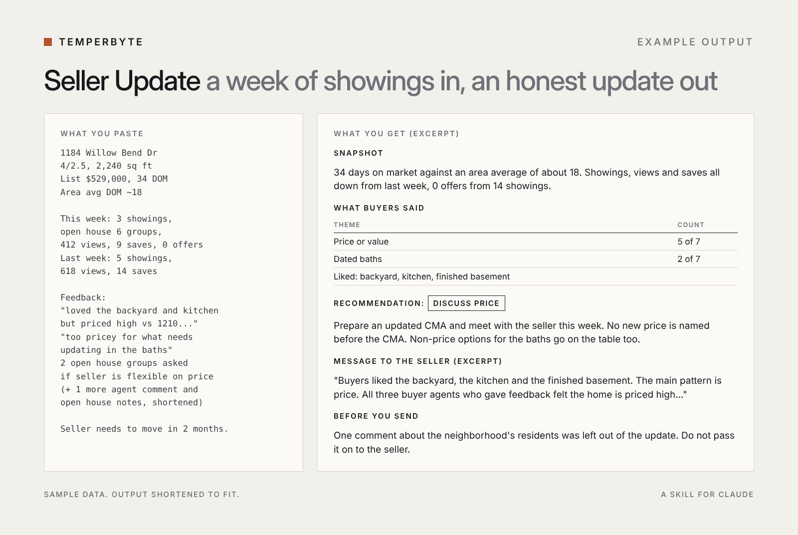
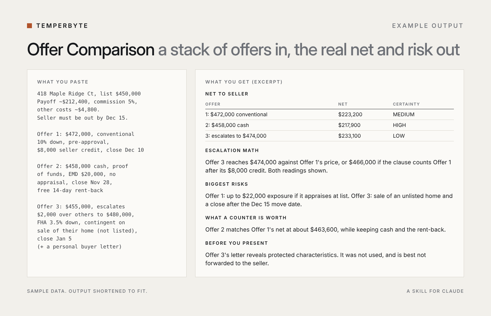

# Temperbyte Skills

Free Claude skills for real estate agents and fitness coaches. Each skill does one job you repeat every week. The lite versions here are cut down from full skills that were tested side by side against plain Claude.

| Skill | What it does | Download |
|---|---|---|
| `listing-writer-lite` | Turns rough property notes into MLS remarks and headlines, with a fair housing language check | [listing-writer-lite.zip](dist/listing-writer-lite.zip?raw=true) |
| `checkin-analyzer-lite` | Reviews a coaching client's weekly check-in with trend math, a hold/adjust decision and red flags | [checkin-analyzer-lite.zip](dist/checkin-analyzer-lite.zip?raw=true) |

## How to install

**In the Claude app or claude.ai** (works on all plans, including Free):

1. Download the `.zip` file for the skill you want. Don't unzip it.
2. In Claude, go to **Settings > Capabilities** and turn on **Code execution and file creation**.
3. Go to **Customize > Skills**, click **+**, then **Create skill > Upload a skill**, and upload the file. Make sure the skill is toggled on.
4. Start a new chat and paste your notes or check-in. Claude uses the skill automatically. If it doesn't, start your message with the skill's name, for example `Use listing-writer-lite:`.

**In Claude Code**, install both lite skills as a plugin:

```
/plugin marketplace add Temperbyte/temperbyte-skills.
/plugin install temperbyte-lite@temperbyte
```

The source for each skill is in the [`skills/`](skills) folder.

## Full versions

The lite skills cover the core job. The full versions do the whole workflow:

| Full skill | Adds |
|---|---|
| [Listing Writer](https://payhip.com/b/60TYy) | Website description, feature highlights, social caption, facts to verify |
| [Pricing Brief](https://payhip.com/b/7mleY) | Comp math, list price range, confidence level, seller talking points |
| [Seller Update](https://payhip.com/b/UXnhj) | Weekly showing numbers, buyer feedback patterns, a recommendation and a message to the seller |
| [Offer Comparison](https://payhip.com/b/sfl8H) | Side-by-side offers, seller net for each, escalation clause math, closing risk and a seller summary |
| [Check-in Analyzer](https://payhip.com/b/7gC9P) | Adherence and lift tracking, client questions, numbers table |
| [Intake to Program](https://payhip.com/b/gVueK) | Safety screen and a 4-week starting program |

Or get two skills for your field in one download: [Real Estate Kit](https://payhip.com/b/oAUZm) (Listing Writer + Pricing Brief) · [Coach Kit](https://payhip.com/b/BUi0r) (Intake to Program + Check-in Analyzer)

All products: [payhip.com/Temperbyte](https://payhip.com/Temperbyte)

## Examples

Sample data, output shortened to fit.

**Listing Writer**


**Pricing Brief**


**Seller Update**



**Offer Comparison**



**Check-in Analyzer**


**Intake to Program**


## Free calculators

- [Escalation clause calculator](https://temperbyte.github.io/escalation-clause-calculator/): final price and seller net for every offer, including competing escalation clauses
- [Weight trend calculator](https://temperbyte.github.io/weight-trend-calculator/): weekly averages and rate of change from daily weigh-ins

## Guides

- [Fair Housing Words to Avoid in Real Estate Listings (and What to Write Instead)](https://payhip.com/Temperbyte/blog/news/fair-housing-words-to-avoid-in-real-estate-listings-and-what-to-write-instead)
- [How to Price a Listing From Comps: The Median Price-Per-Square-Foot Method](https://payhip.com/Temperbyte/blog/news/how-to-price-a-listing-from-comps-the-median-price-per-square-foot-method)
- [How to Read a Weekly Weigh-In Trend Without Overreacting](https://payhip.com/Temperbyte/blog/news/how-to-read-a-weekly-weigh-in-trend-without-overreacting)
- [Escalation Clause Math: How to Calculate the Final Price and the Seller's Net](https://payhip.com/Temperbyte/blog/news/escalation-clause-math-how-to-calculate-the-final-price-and-the-seller-s-net)
- [How to Compare Multiple Offers: Why the Highest Price Is Not Always the Best Offer](https://payhip.com/Temperbyte/blog/news/how-to-compare-multiple-offers-why-the-highest-price-is-not-always-the-best-offer)

## License

The lite skills in this repository are MIT licensed. They are tools for professionals and do not replace professional or legal review.
