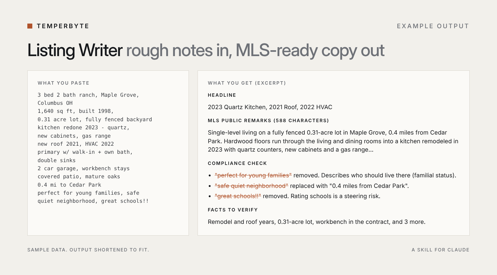
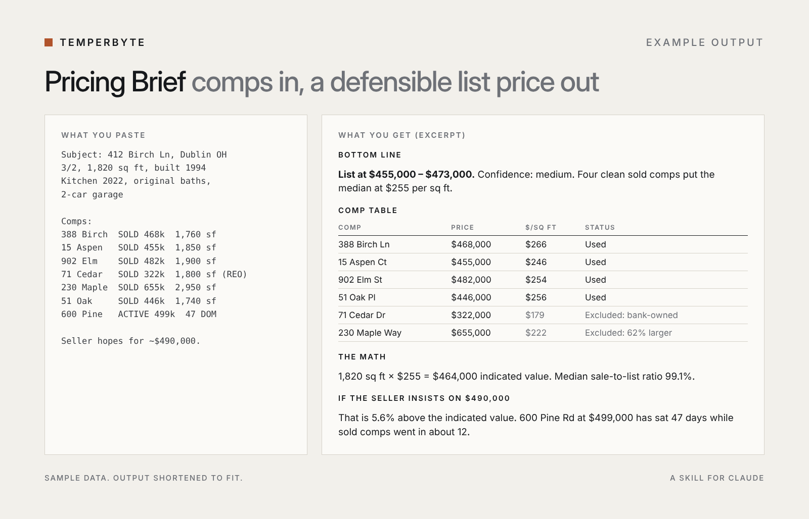
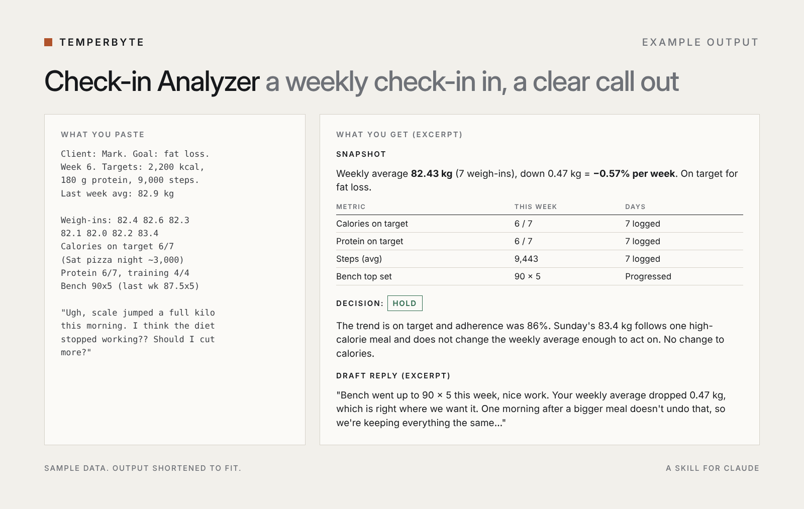
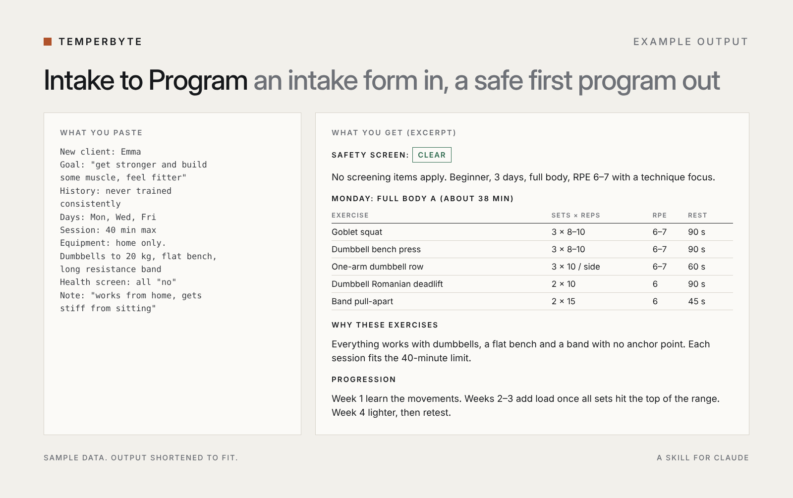

# Temperbyte Skills

Free Claude skills for real estate agents and fitness coaches. Each skill does one job you repeat every week. The lite versions here are cut down from full skills that were tested side by side against plain Claude.

| Skill | What it does | Download |
|---|---|---|
| `listing-writer-lite` | Turns rough property notes into MLS remarks and headlines, with a fair housing language check | [listing-writer-lite.zip](dist/listing-writer-lite.zip?raw=true) |
| `checkin-analyzer-lite` | Reviews a coaching client's weekly check-in with trend math, a hold/adjust decision and red flags | [checkin-analyzer-lite.zip](dist/checkin-analyzer-lite.zip?raw=true) |

## How to install

1. Download the `.zip` file for the skill you want. Don't unzip it.
2. In Claude, go to **Settings > Capabilities > Skills** and upload the file.
3. Start a new chat and paste your notes or check-in. Claude uses the skill automatically.

Requires a Claude plan that supports Skills. The source for each skill is in the [`skills/`](skills) folder.

## Full versions

The lite skills cover the core job. The full versions do the whole workflow:

| Full skill | Adds |
|---|---|
| [Listing Writer](https://payhip.com/b/60TYy) | Website description, feature highlights, social caption, facts to verify |
| [Pricing Brief](https://payhip.com/b/7mleY) | Comp math, list price range, confidence level, seller talking points |
| [Check-in Analyzer](https://payhip.com/b/7gC9P) | Adherence and lift tracking, client questions, numbers table |
| [Intake to Program](https://payhip.com/b/gVueK) | Safety screen and a 4-week starting program |

Or get both skills for your field: [Real Estate Kit](https://payhip.com/b/oAUZm) · [Coach Kit](https://payhip.com/b/BUi0r)

All products: [payhip.com/Temperbyte](https://payhip.com/Temperbyte)

## Examples

Sample data, output shortened to fit.

**Listing Writer**

**Pricing Brief**

**Check-in Analyzer**

**Intake to Program**

## License

The lite skills in this repository are MIT licensed. They are tools for professionals and do not replace professional or legal review.
